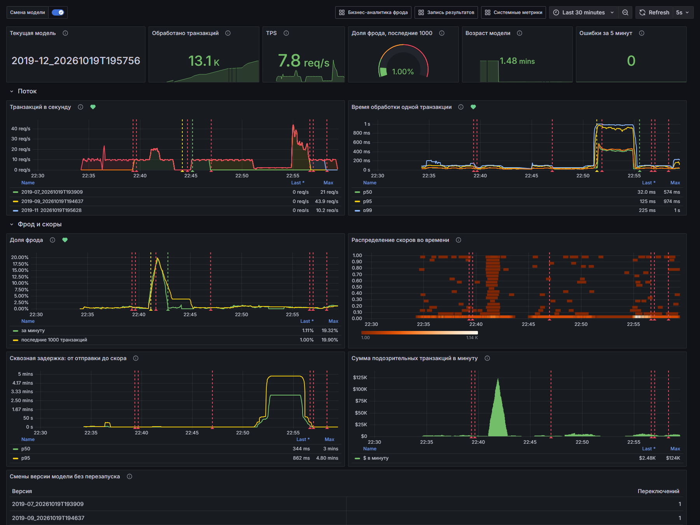
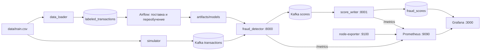
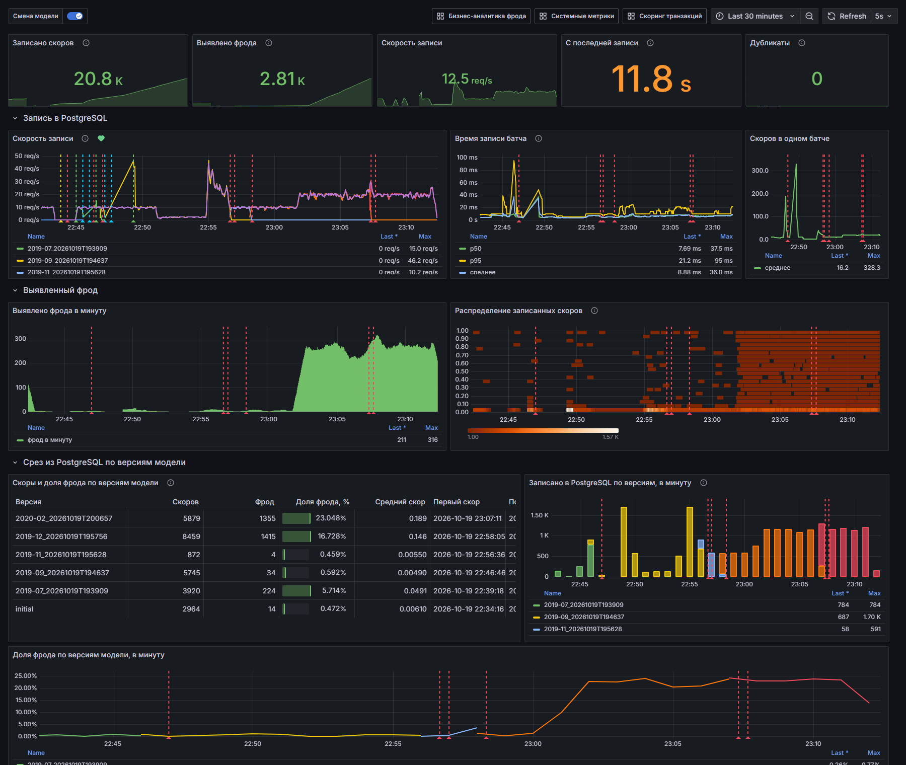
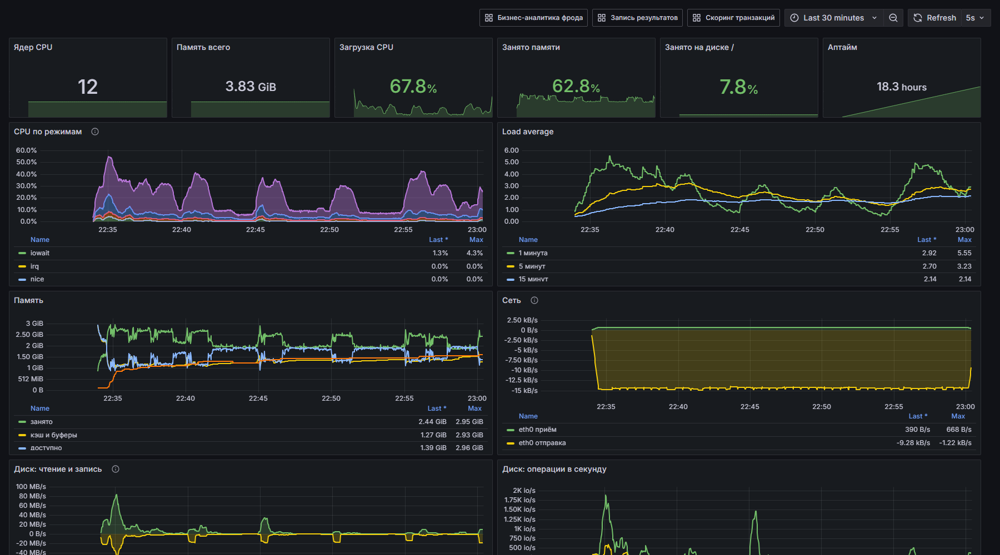
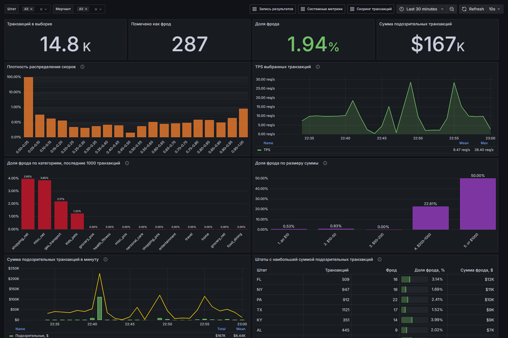
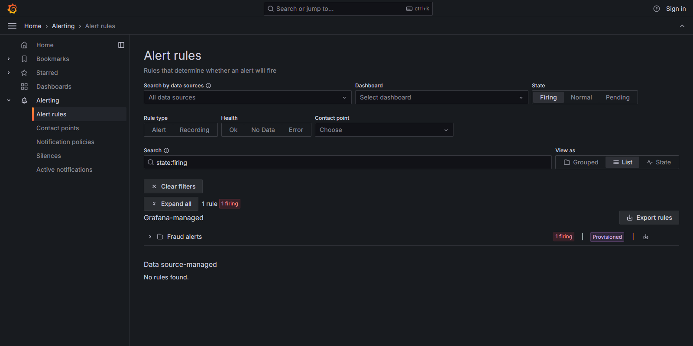

# Мониторинг скоринга фрода: Prometheus и Grafana

Продолжение сервиса скоринга из прошлых домашних заданий. Транзакции по-прежнему идут потоком через Kafka, `fraud_detector` отдаёт `score` и `fraud_flag`, `score_writer` складывает результаты в PostgreSQL, а Airflow дописывает размеченные месяцы и переобучает модель.

Поверх этого добавлена наблюдаемость:

- оба сервиса отдают метрики в формате Prometheus;
- Prometheus собирает их и метрики Node Exporter раз в секунду;
- в Grafana при старте появляются источники данных, четыре дашборда и четыре правила алертов;
- на графиках скоринга отмечается момент, когда сервис подхватил новую версию модели.



## Архитектура



| Сервис | Что делает |
|---|---|
| `zookeeper`, `kafka`, `kafka-setup` | брокер и топики `transactions` и `scores` |
| `postgres` | размеченная витрина, состояние переобучения, таблица результатов `fraud_scores`, база метаданных Airflow |
| `data_loader` | при первом старте загружает `train.csv` в витрину |
| `simulator` | шлёт в `transactions` 10 случайных транзакций в секунду, бесконечно |
| `fraud_detector` | скорит поток текущей моделью из `artifacts/models`, пишет в `scores`, метрики на порту 8000 |
| `score_writer` | пишет результаты из `scores` в `fraud_scores`, метрики на порту 8001 |
| `airflow` | DAG поставки нового месяца, DAG переобучения с публикацией модели и DAG проверки качества данных |
| `prometheus` | собирает метрики раз в секунду |
| `grafana` | дашборды и алерты, всё подключается через provisioning |
| `node-exporter` | системные метрики хоста: CPU, память, сеть, диск |
| `kafka-ui` | просмотр топиков, запускается отдельно, см. ниже |

Все сервисы находятся в одной сети `fraud-monitoring`.

## Запуск

Нужны Docker и Docker Compose v2 и около 3 ГБ свободной памяти. Должны быть свободны порты 3000, 5433, 8000, 8001, 8081, 9090 и 9095.

1. Скачайте `train.csv` соревнования https://www.kaggle.com/competitions/teta-ml-1-2025/data и положите его в `data/train.csv`. Файл весит 145 МБ, поэтому в репозитории его нет.

2. Поднимите проект:

   ```bash
   docker compose up -d --build
   ```

   Первая сборка занимает 5–15 минут, в основном из-за CatBoost в образах скоринга и Airflow. После сборки стенд поднимается примерно за 2 минуты: `data_loader` загружает витрину, затем стартует Airflow.

3. Проверьте статус:

   ```bash
   docker compose ps -a
   ```

   `kafka`, `postgres`, `airflow`, `prometheus` и `grafana` должны быть в статусе `healthy`, остальные в `Up`. `kafka-setup`, `data_loader` и `artifacts-init` одноразовые, они завершаются с `Exited (0)`.

Kafka UI по умолчанию не запускается, чтобы сэкономить память. Если нужен:

```bash
docker compose --profile ui up -d kafka-ui
```

## Адреса

| Что | Где | Доступ |
|---|---|---|
| Grafana | http://localhost:3000 | `admin` / `admin`, просматривать можно и без входа |
| Prometheus | http://localhost:9090 | без пароля, цели на http://localhost:9090/targets |
| Метрики скоринга | http://localhost:8000/metrics | |
| Метрики записи | http://localhost:8001/metrics | |
| Airflow | http://localhost:8081 | `admin` / `admin` |
| PostgreSQL | `localhost:5433`, база `fraud` | `fraud` / `fraud`, для Grafana отдельная роль `grafana` / `grafana` только на чтение |
| Kafka UI | http://localhost:8080 | только с профилем `ui` |

При первом входе под `admin` Grafana предлагает сменить пароль, кнопка Skip оставляет прежний.

Дашборды лежат в папке Dashboards → Fraud monitoring, домашняя страница Grafana открывает дашборд скоринга. Алерты находятся в Alerting → Alert rules, папка Fraud alerts.

| Дашборд | Ссылка |
|---|---|
| Скоринг транзакций | http://localhost:3000/d/fraud-scoring |
| Запись результатов | http://localhost:3000/d/fraud-writer |
| Системные метрики | http://localhost:3000/d/fraud-system |
| Бизнес-аналитика фрода | http://localhost:3000/d/fraud-business |

## Что лежит в репозитории для мониторинга

```
prometheus/prometheus.yml                      цели и интервал сбора 1 с
grafana/provisioning/datasources/datasources.yml   Prometheus и PostgreSQL
grafana/provisioning/dashboards/dashboards.yml     откуда брать дашборды
grafana/provisioning/alerting/rules.yml            правила алертов
grafana/dashboards/*.json                          четыре дашборда
fraud_detector/metrics.py                          метрики скоринга
score_writer/app.py                                метрики записи
```

Источники данных, дашборды и алерты подключаются сами при старте Grafana, руками ничего настраивать не нужно.

## Метрики

### fraud_detector, порт 8000

Сервис обрабатывает сообщения по одному, и все метрики обновляются на каждой транзакции.

| Метрика | Тип | Что значит |
|---|---|---|
| `fraud_scorer_transactions_total{model_version}` | counter | обработанные транзакции с разбивкой по версии модели |
| `fraud_scorer_flagged_total{model_version}` | counter | транзакции с `fraud_flag = 1` |
| `fraud_scorer_processing_seconds` | histogram | время обработки одной транзакции: препроцессинг, инференс и отправка в Kafka |
| `fraud_scorer_score` | histogram | распределение скоров, бакеты по 0.05 |
| `fraud_scorer_fraud_ratio` | gauge | доля фрода среди последних 1000 транзакций |
| `fraud_scorer_model_switches_total{version}` | counter | горячая подмена модели, метка содержит новую версию |
| `fraud_scorer_model_info{version}` | gauge | текущая модель, значение всегда 1 |
| `fraud_scorer_model_threshold` | gauge | порог `fraud_flag` текущей модели |
| `fraud_scorer_model_trained_timestamp_seconds` | gauge | время обучения текущей модели |
| `fraud_scorer_end_to_end_seconds` | histogram | от отправки транзакции симулятором до отправки её скора |
| `fraud_scorer_flagged_amount_dollars_total` | counter | сумма платежей, помеченных как фрод, в долларах |
| `fraud_scorer_errors_total{stage}` | counter | сообщения, которые не удалось разобрать (`parse`) или отскорить (`predict`) |

### score_writer, порт 8001

| Метрика | Тип | Что значит |
|---|---|---|
| `score_writer_scores_written_total{model_version}` | counter | записанные в PostgreSQL скоры |
| `score_writer_fraud_written_total` | counter | записанные скоры с `fraud_flag = 1` |
| `score_writer_write_seconds` | histogram | время записи батча: INSERT и COMMIT |
| `score_writer_score` | histogram | распределение записанных скоров |
| `score_writer_batch_rows` | histogram | сколько скоров в одной записи |
| `score_writer_duplicates_total` | counter | скоры, которые уже были в таблице (повторная доставка из Kafka) |
| `score_writer_malformed_total` | counter | сообщения, которые не удалось разобрать |
| `score_writer_last_write_timestamp_seconds` | gauge | время последней успешной записи |

### Node Exporter

Стандартные `node_cpu_seconds_total`, `node_memory_*`, `node_network_*`, `node_disk_*`, `node_filesystem_*` и `node_load*`.

### Метрики, которых нет в семинаре

**`fraud_scorer_end_to_end_seconds`, сквозная задержка.** Симулятор кладёт в сообщение время отправки `sent_at`, и сервис считает, сколько прошло до отправки скора. Время обработки одной транзакции показывает только работу самой модели. Если же скоринг не успевает за потоком, сообщения копятся в Kafka. Время обработки при этом может оставаться прежним, а результат приходит с опозданием, и для антифрода это главное: решение по платежу нужно, пока платёж ещё идёт. Смотреть на дашборде «Скоринг транзакций», панель «Сквозная задержка: от отправки до скора». На скриншоте выше видно, как при ограничении CPU задержка выросла до нескольких минут, а затем вернулась к норме, когда очередь разобралась.

**`fraud_scorer_flagged_amount_dollars_total`, сумма подозрительных платежей.** Доля фрода говорит, сколько транзакций помечено, но не сколько денег за этим стоит. Десять помеченных переводов по $5 и один по $5000 дают разную нагрузку на службу проверки и разный риск. Панель «Сумма подозрительных транзакций в минуту» на дашборде скоринга.

**`fraud_scorer_model_trained_timestamp_seconds`, возраст модели.** Если переобучение перестало публиковать модели, сервис продолжает работать, но на всё более старой модели. Панель «Возраст модели».

**`fraud_scorer_errors_total`, `score_writer_duplicates_total`, `score_writer_last_write_timestamp_seconds`.** Ошибки разбора и инференса, повторные доставки и остановка записи. На последней метрике построен алерт.

## Дашборды

### Скоринг транзакций

- текущая модель, всего обработано, TPS, доля фрода за последние 1000, возраст модели, ошибки;
- транзакций в секунду, сложено по версиям модели: после смены модели видно, как поток переходит на новую версию;
- время обработки одной транзакции: p50, p95, p99 и среднее;
- доля фрода: по скорости счётчиков за минуту и по окну последних 1000;
- heatmap распределения скоров во времени;
- сквозная задержка p50 и p95;
- сумма подозрительных транзакций в минуту;
- таблица смен версии модели.

На всех графиках этого дашборда включена аннотация «Смена модели», см. следующий раздел.

### Запись результатов



- записано скоров, выявлено фрода, скорость записи, секунд с последней записи, дубликаты;
- скорость записи по версиям модели рядом со скоростью скоринга;
- время записи батча p50, p95 и среднее, размер батча;
- выявленный фрод в минуту и heatmap записанных скоров;
- срез из PostgreSQL: таблица со скорами, фродом и долей фрода по каждой версии модели, записи по минутам и доля фрода по минутам в разрезе версии. Это источник `PostgreSQL`, а не Prometheus: на одном экране видно и то, что процесс жив, и то, какая версия что насчитала.

### Системные метрики



Ядра, память, загрузка CPU и памяти, место на диске, аптайм, CPU по режимам, load average, память с кэшем и swap, сеть по интерфейсам, чтение и запись диска, IOPS.

### Бизнес-аналитика фрода



Все панели строятся по таблице `fraud_scores` через источник PostgreSQL. Вверху два фильтра: **Штат** (`us_state`) и **Мерчант** (`merch`). Можно выбрать несколько значений или All. Список мерчантов зависит от выбранных штатов.

| Панель | Что показывает | Фильтры |
|---|---|---|
| Транзакций, фрод, доля фрода, сумма подозрительных | итог по выборке | да |
| Плотность распределения скоров | доля транзакций в каждом интервале скора шириной 0.05, ось Y логарифмическая | да |
| TPS выбранных транзакций | сколько транзакций выбранных штатов и мерчантов скорится в секунду | да |
| Доля фрода по категориям, последние 1000 транзакций | barplot средней доли `fraud_flag = 1` по `cat_id` среди 1000 последних записанных скоров | нет, это всегда последние 1000 |
| Доля фрода по размеру суммы | свой график, см. ниже | да |
| Сумма подозрительных транзакций в минуту | свой график, см. ниже | да |
| Штаты с наибольшей суммой подозрительных транзакций | свой график, см. ниже | да |

Свои графики:

- **Доля фрода по размеру суммы.** Фрод сосредоточен в крупных платежах: транзакции до $200 модель почти не помечает, а начиная с $200 доля фрода выше в десятки раз. По этому графику удобно выбирать порог, с которого платёж стоит отправлять на ручную проверку.
- **Сумма подозрительных транзакций в минуту** на фоне общего оборота. Это денежный объём, который модель предлагает остановить, то есть нагрузка на службу проверки и деньги под риском.
- **Штаты с наибольшей суммой подозрительных транзакций.** Подсказывает, куда в первую очередь направлять ручную проверку.

Чтобы эти срезы были возможны, `fraud_detector` кладёт в сообщение со скором ещё `us_state`, `merch`, `cat_id` и `amount` из исходной транзакции, а `score_writer` пишет их в `fraud_scores`. Поля контракта `transaction_id`, `score`, `fraud_flag` и `model_version` остались прежними:

```json
{"transaction_id": "5f0c...", "score": 0.00042, "fraud_flag": 0, "model_version": "2019-07_20261019T193909",
 "us_state": "TX", "merch": "fraud_Kirlin and Sons", "cat_id": "shopping_net", "amount": 12.5}
```

## Отметка смены версии модели

`fraud_detector` перед каждым батчем сообщений проверяет `artifacts/models/latest.json`. Если Airflow опубликовал новую модель, сервис загружает её без перезапуска контейнера и увеличивает `fraud_scorer_model_switches_total{version="<новая версия>"}`.

На дашбордах скоринга и записи настроена аннотация по запросу

```promql
(fraud_scorer_model_switches_total unless fraud_scorer_model_switches_total offset 30s)
  or (increase(fraud_scorer_model_switches_total[30s]) > 0)
```

Первая часть ловит появление новой серии с новой версией, вторая срабатывает, если та же версия будет подхвачена повторно. Отметка держится около 30 секунд, это красная полоса на всех графиках. При наведении на треугольник внизу видна подпись «Модель <версия>».

### Как увидеть отметку

1. Откройте http://localhost:3000/d/fraud-scoring.
2. Запустите переобучение с принудительной публикацией:

   ```bash
   docker compose exec airflow airflow dags trigger retrain_fraud_model -c '{"force_publish": true}'
   ```

   То же самое в UI Airflow: DAG `retrain_fraud_model`, кнопка Trigger DAG, галочка `force_publish`. Прогон занимает 1.5–2 минуты.

3. Когда задача `publish_model` станет зелёной, в течение нескольких секунд:
   - в логе `docker compose logs fraud_detector | grep Switched` появится строка `Switched model ... -> 2019-..`;
   - на всех графиках дашборда появится красная отметка с именем новой версии;
   - панель «Текущая модель» и таблица «Смены версии модели» покажут новую версию;
   - на «Транзакций в секунду» поток перейдёт на серию с новой версией.

Плановые прогоны переобучения тоже идут каждые 5 минут, но публикуют модель, только если она не хуже текущей по PR-AUC на свежем месяце. Поэтому без `force_publish` отметки появляются реже. Подробнее о переобучении ниже.

## Алерты

Правила лежат в `grafana/provisioning/alerting/rules.yml`, Grafana загружает их при старте. Найти их можно в Alerting → Alert rules → Fraud alerts. Правила проверяются каждые 10 секунд. Доставка в почту или Telegram не настроена, сработавший алерт виден в разделе Alerting со статусом Firing и отметкой на связанной панели.

| Алерт | Условие | Сколько держится до Firing |
|---|---|---|
| Доля фрода выше 5% | `100 * sum(rate(fraud_scorer_flagged_total[1m])) / sum(rate(fraud_scorer_transactions_total[1m])) > 5` | 30 с |
| Поток транзакций остановился | `sum(rate(fraud_scorer_transactions_total[1m])) < 1`, а также если метрик нет совсем | 30 с |
| Время обработки транзакции выросло | p95 `fraud_scorer_processing_seconds` за минуту больше 0.25 с | 30 с |
| Запись скоров в PostgreSQL остановилась | `time() - score_writer_last_write_timestamp_seconds > 30`, а также если метрик нет совсем | 30 с |

Пороги подобраны по нормальной работе стенда: доля фрода 0.4–1%, p95 обработки 50–80 мс, запись каждую секунду.



### Как проверить срабатывание

Каждый сценарий проверен на стенде, время указано с запасом.

**Доля фрода.** Запустите второй симулятор, в котором 60% транзакций мошеннические:

```bash
docker compose run -d --rm --name fraud-burst -e FRAUD_SHARE=0.6 simulator
```

Через 1–1.5 минуты алерт станет Firing, на панели «Доля фрода» будет всплеск. Остановите симулятор, и примерно через минуту алерт вернётся в Normal:

```bash
docker rm -f fraud-burst
```

**Остановка потока.**

```bash
docker compose stop simulator
```

Через 30–60 секунд «Поток транзакций остановился» станет Firing. Затем сработает и «Запись скоров остановилась»: писать стало нечего. Вернуть поток:

```bash
docker compose start simulator
```

**Остановка записи.**

```bash
docker compose stop score_writer
```

Через минуту «Запись скоров в PostgreSQL остановилась» станет Firing. После `docker compose start score_writer` writer дочитает накопившиеся скоры, и алерт погаснет.

**Время обработки.** Ограничьте скорингу процессор до 0.1 ядра:

```bash
docker update --cpus 0.1 $(docker compose ps -q fraud_detector)
```

Через минуту p95 вырастет почти до секунды, и алерт станет Firing. Заодно на панели сквозной задержки видно, как копится очередь. Снять ограничение проще всего пересозданием контейнера:

```bash
docker compose up -d --force-recreate fraud_detector
```

## Как убедиться, что метрики идут с потока

1. Страница метрик растёт. Повторите команду несколько раз: счётчики увеличиваются примерно на 10 в секунду, с той же скоростью, с какой шлёт симулятор:

   ```bash
   curl -s localhost:8000/metrics | grep ^fraud_scorer_transactions_total
   curl -s localhost:8001/metrics | grep ^score_writer_scores_written_total
   ```

2. В Prometheus на http://localhost:9090/targets все четыре цели (`fraud_detector`, `score_writer`, `node`, `prometheus`) в статусе UP. Запрос `sum(rate(fraud_scorer_transactions_total[30s]))` на вкладке Graph показывает около 10 транзакций в секунду, столько шлёт симулятор.

3. На дашборде «Скоринг транзакций» TPS около 10, счётчик «Обработано транзакций» растёт, heatmap скоров заполняется. Если остановить симулятор (`docker compose stop simulator`), TPS падает до нуля, а после `docker compose start simulator` возвращается.

4. В PostgreSQL копятся строки:

   ```bash
   docker compose exec postgres psql -U fraud -d fraud -c "SELECT model_version, count(*), max(created_at) FROM fraud_scores GROUP BY 1 ORDER BY 3 DESC;"
   ```

## Переобучение

Переобучение осталось из прошлого задания, здесь только кратко.

- `supply_labeled_month`, раз в 5 минут: дописывает в витрину `labeled_transactions` новый месяц из 50 000 строк и удаляет историю старше 24 месяцев.
- `retrain_fraud_model`, раз в 5 минут: берёт скользящее окно из 4 месяцев, обучает CatBoost на трёх ранних и проверяет на самом свежем. Если новая модель не хуже текущей по PR-AUC на этом месяце, публикует её в `artifacts/models/<версия>/` и атомарно переписывает `latest.json`. Параметр `force_publish` публикует модель без сравнения.
- `data_quality`, раз в 15 минут: семь правил качества витрины и HTML-отчёт в `artifacts/dq_reports/latest.html`.

До первой публикации сервис работает на стартовой модели `initial` из `fraud_detector/initial_model/`. Версия модели имеет вид `2019-07_20261019T193909`: месяц, на котором модель проверялась, и время обучения.

## Структура

```
.
├── docker-compose.yml
├── prometheus/                  конфигурация Prometheus
├── grafana/                     provisioning и дашборды
├── docs/                        скриншоты дашбордов и алертов
├── fraud_detector/              сервис скоринга, metrics.py, стартовая модель
├── score_writer/                запись результатов и её метрики
├── simulator/                   поток транзакций
├── data_loader/                 первичная загрузка витрины
├── postgres/init.sql            таблицы и роль grafana
├── dags/, pipeline/, airflow/   переобучение в Airflow
├── fraud_core/                  препроцессинг, обучение, формат модели
├── scripts/                     пересборка стартовой модели
├── data/                        сюда положить train.csv
└── artifacts/                   опубликованные модели и отчёты DQ
```

## Остановка

```bash
docker compose down       # данные, метрики и состояние Grafana сохраняются
docker compose down -v    # удалить базы, историю Prometheus и состояние Grafana
```

`artifacts/` лежит на хосте, и `down -v` его не трогает. Чтобы начать полностью с нуля, удалите и содержимое `artifacts/models` и `artifacts/dq_reports`, оставив `.gitkeep`.
